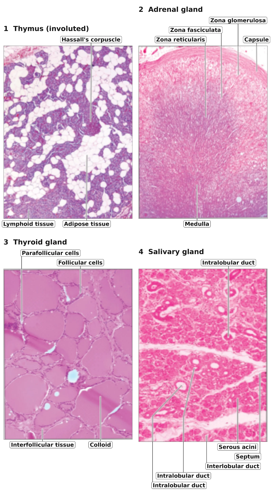

# Salivary Gland

Image 4 is a **salivary gland** (parotid or submandibular), an **exocrine** gland. Its secretory **serous acini** pour their product into **intralobular ducts**, which drain to the surface. It has no ductless secretion into blood, so it is the only non-endocrine structure among the four.

## Trigger Point

> "Which histology image is **not** an endocrine structure?" Look for the image with **ducts**, since endocrine glands are ductless.

## Why Not the Other Options?

**A. Image 1 (Thymus)**
An involuted thymus, with lymphoid tissue replaced by adipose tissue. It is a primary lymphoid organ, and its epithelial reticular cells secrete **thymosin** and thymopoietin, so it is classed as an endocrine structure.

**B. Image 2 (Adrenal gland)**
Shows the capsule, then **zona glomerulosa, fasciculata and reticularis**, with the medulla deep to them. It is a classic ductless endocrine gland.

**C. Image 3 (Thyroid)**
Shows **colloid-filled follicles** lined by follicular cells. It is a ductless endocrine gland that stores its hormone extracellularly.

## Mind Capsule

> Endocrine = ductless (follicles, cords, clumps) + rich capillaries.
> Acini + intralobular ducts + septa = exocrine (salivary gland).

## Memory Hook

> **GFR: Salt, Sugar, Sex**: Adrenal cortex zones from outside in: **G**lomerulosa (mineralocorticoids), **F**asciculata (glucocorticoids), **R**eticularis (sex steroids).
